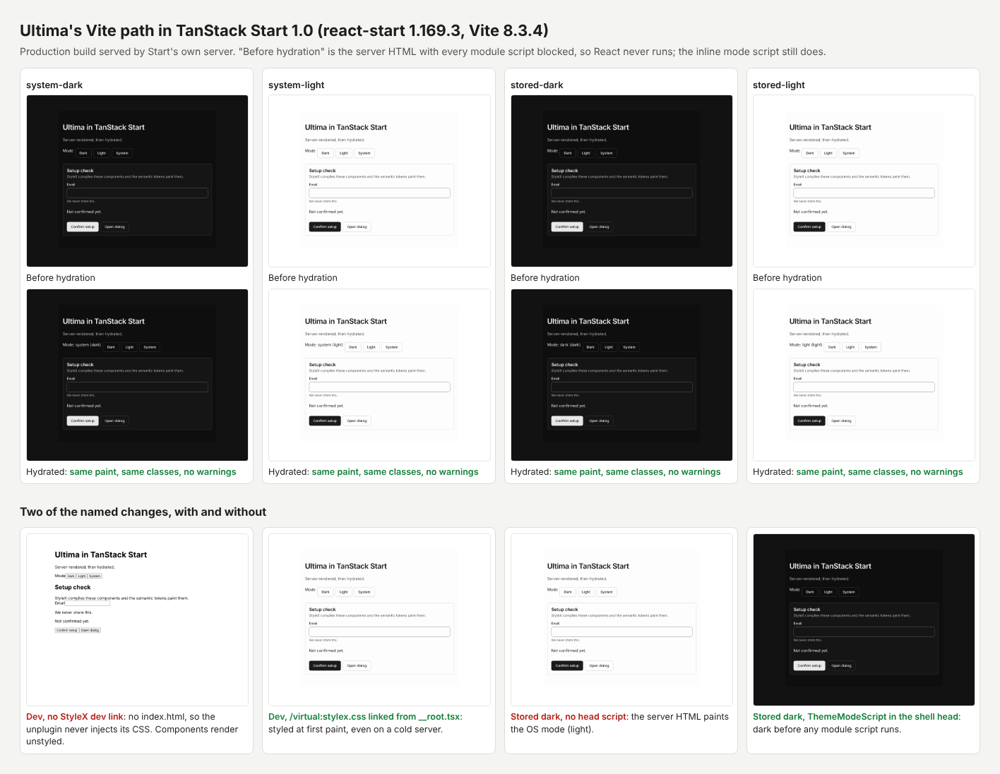

# Does Ultima's Vite path work in TanStack Start 1.0?

Spike for [#852](https://github.com/frankieramirez/ultima/issues/852), run on 2026-10-17 against this repository at `8ede17a`.

## Findings

**The runtime works. Ultima's tools do not recognize the app.** With six changes to the Vite guide, a fresh Start app renders Ultima on the server and hydrates it cleanly. Class names match between the server and client builds. All StyleX output lands in one stylesheet. No mode flashes before hydration, in dark, light, or system mode. The external production cases pass 48 of 48 assertions against Start's own server. But `init` refuses the app, `doctor` exits 3 (incomplete) on a correct setup, and the external runner crashes before it opens a browser. All three look for `index.html` and `src/main.tsx`, which Start does not have.



**Recommendation: add a `--framework tanstack-start` target with matrix cells.** Reasons are under [Recommendation](#recommendation).

| Spike step | Result |
| --- | --- |
| Fresh Start 1.0 app, versions and layout | Done. `@tanstack/react-start` 1.169.3, Vite 8.3.4 |
| `ultima-design init` on it | Fail: detects Vite, then blocks with four repairs |
| Vite install guide by hand | Pass with six changes, two of which fail silently without the fix |
| `doctor` | Incomplete, exit 3 (`ULT-SETUP-016`), plus a false theme advisory |
| `check` | Pass, exit 0 |
| StyleX lint | Pass, exit 0: 0 errors, 9 warnings, all `no-unused` or a stale directive |
| Production build | Pass |
| External production cases (`consumer-external.ts`) | Unchanged runner: crash. Runner with Start's server swapped in: pass, 4 cases, 48 of 48 |
| First paint and hydration, dark, light and system | Production: pass, 7 checks in each of 4 modes. Dev: pass only with the dev stylesheet link |

## The app

Scaffolded with the TanStack CLI:

```sh
npx @tanstack/cli@0.72.0 create start-app --framework React --blank \
  --package-manager npm --no-git --no-toolchain --no-intent --non-interactive
```

`--blank` is the default this spike picked. Per the CLI's own help, the standard scaffold always enables Tailwind, and Ultima does not use Tailwind. Start's "1.0" line continues the router's version numbers; 1.169.3 was the latest release on 2026-10-16.

| Package | Version |
| --- | --- |
| `@tanstack/react-start` | 1.169.3 |
| `@tanstack/react-router` | 1.170.45 |
| `@tanstack/router-plugin` (via `start-plugin-core` 1.171.54) | 1.168.47, which pulls `unplugin` 3.4.0 |
| `vite` | 8.3.4 |
| `@vitejs/plugin-react` | 6.1.2 |
| `react`, `react-dom` | 19.3.1 |
| `typescript` | 6.0.3 |
| Node | 22.22.0 |

Ultima side: `ultima-design` 0.1.0 packed from this commit, the registry built from this commit and served on loopback, `shadcn` 4.21.4, `@stylexjs/stylex` and `@stylexjs/unplugin` 0.19.1, `@base-ui/react` 1.9.0, Chromium 141.0.7390.37.

```text
start-app/
  .cta.json  .gitignore  .vscode/settings.json  README.md
  package.json  package-lock.json  tsconfig.json  tsr.config.json  vite.config.ts
  src/
    router.tsx           getRouter() over the generated route tree
    routeTree.gen.ts     generated by tsr
    routes/__root.tsx    createRootRoute: head() meta and links, shellComponent renders <html>
    routes/index.tsx     createFileRoute('/')
    styles.css           an unlayered * and body reset, plus a main rule
```

There is no `index.html` and no `src/main.tsx`. `__root.tsx` links `styles.css` through `import appCss from '../styles.css?url'` in `head().links`. `tsconfig.json` already maps both `#/*` and `@/*` to `./src/*`, so the setup item's first hand step is already done. `vite build` writes `dist/client/` (assets only, no HTML) and `dist/server/server.js`; `vite preview` serves the result through Start's server.

## What `init` detects and plans

`ultima init . --plan --json`, with and without `--framework vite`, gives the same result. Verbatim:

```text
ultima init: …/start-app needs manual repair before init can set it up
  - index.html: index.html does not exist, so the application uses a custom source root.
    Repair: Custom source roots follow the manual setup at https://ultima.systems/install.
  - src/main.tsx: src/main.tsx does not exist, so the application uses a custom source root.
    Repair: Custom source roots follow the manual setup at https://ultima.systems/install.
  - vite.config.ts: vite.config.ts computes its config (config…), which init does not execute.
    Repair: Put `ultimaStylex()` first in plugins by hand, as https://ultima.systems/install describes, then plan again.
  - index.html: None of index.html, src/main.* exists, so no stylesheet could be followed from the entry.
    Repair: Restore the entry the target scaffold ships. init moves only recognized reset rules in the application's own stylesheets.
Nothing was written. Repair each one, then plan again.
```

The plan's status is `blocked` and it exits 1. Two of the four conflicts are entry-based and cannot be repaired in a Start app. The `vite.config.ts` conflict is a parser limit, not a computed config: Start's scaffold writes `const config = defineConfig({ … })` and then `export default config`. `@tanstack/react-router` appears only as a router dependency (`packages/cli/src/existing.ts:633`), and nothing reads `@tanstack/react-start`.

## The Vite guide by hand

Each step of [Install](../../apps/docs/src/content/install.mdx) and the `setup-vite` item's `docs`, in order.

1. **`npx shadcn@4.21.4 add …/r/setup-vite.json` fails on npm.** Start's router plugin hoists `unplugin` 3.4.0. `@stylexjs/unplugin` 0.19.1 declares the peer `unplugin@^2.3.11`, and `setup-vite` lists bare `unplugin` as a devDependency, so npm stops with `ERESOLVE … Conflicting peer dependency: unplugin@2.3.11`. Pinning the item's devDependency to `unplugin@^2.3.11` still fails, tested on a fresh copy, and so does one `npm install -D unplugin@^2.3.11 @stylexjs/unplugin@0.19.1`. What works is two installs: `npm install -D unplugin@^2.3.11` first, which nests 3.4.0 under the router plugin, then the setup item. pnpm was not tried. The lasting fix is upstream: StyleX's unplugin accepting `unplugin` 3.
2. **`tsconfig.json` paths:** already present in the scaffold.
3. **`vite.config.ts`:** import `ultimaStylex` and put it first, before `tanstackStart()` and the React plugin. It works as written. Order tried: `[ultimaStylex(), tanstackStart(), viteReact()]`.
4. **Reset in a layer:** the blank scaffold's `* { box-sizing }` and `body { margin; font-family }` are unlayered, the same problem the guide names for create-next-app. Wrapped in `@layer reset`. The scaffold's unlayered `main { width; margin }` stays, and wins over the page's own StyleX margin, as any unlayered rule would.
5. **`components.json`:** `tailwind.css` names `src/index.css`, which Start does not have. Pointed at `src/styles.css`. Nothing failed without it, but the path is wrong for this layout.
6. **Components:** `npx shadcn@4.21.4 add @ultima/button @ultima/card @ultima/dialog @ultima/field @ultima/input @ultima/theme-mode` installs into `src/components/ui` and `src/lib` through the `@/` alias, unchanged.
7. **The theme, linked from `__root.tsx`.** The Theme Studio item for the stock Neutral draft installs `ultima-theme.css`, `ultima-theme.json` and `DESIGN.md`. The guide's step is a side-effect import in `src/main.tsx`. In Start it is a second `?url` link in the root route's `head()`, after the app stylesheet:

   ```tsx
   import appCss from '../styles.css?url'
   import themeCss from '../../ultima-theme.css?url'

   links: [
     { rel: 'stylesheet', href: appCss },
     { rel: 'stylesheet', href: themeCss },
   ],
   ```

   The production cascade holds. The unplugin appends its rules to the first CSS asset in the client bundle, which is `styles.css`, so the server HTML links StyleX first and the theme second. The theme file is unlayered and every StyleX rule is layered, so the theme would win even in the other order.
8. **Mode before hydration.** The Vite guide puts `themeModeScript()`'s output in `index.html`. Start has no `index.html`; the Next.js pattern applies verbatim instead: `<ThemeModeScript />` first in the shell's `<head>`, and `suppressHydrationWarning` on `<html>`. React hoists the stylesheet links above the script in the served head, which is harmless: both are in `<head>` and block first paint.
9. **Dev only: the StyleX stylesheet.** The setup item turns on the unplugin's `dev` mode, which serves collected rules at `/virtual:stylex.css`. In a Vite app the plugin injects that link through `transformIndexHtml`. Start has no `index.html`, so nothing injects it, and `vite dev` renders every component unstyled (bottom left of the graphic). The fix is two dev-only entries in the root route's `head()`:

   ```tsx
   links: [ …, ...(import.meta.env.DEV ? [{ rel: 'stylesheet', href: '/virtual:stylex.css' }] : []) ],
   scripts: import.meta.env.DEV ? [{ type: 'module', src: '/@id/virtual:stylex:runtime' }] : [],
   ```

   With them the first paint is styled, even on a cold dev server with `node_modules/.vite` removed, and the production build is unchanged.

The six changes against the guide, then: install `unplugin@^2.3.11` before the setup item on npm; point `components.json` at `src/styles.css`; link the theme from `head().links` with `?url`; render `ThemeModeScript` in the shell head with `suppressHydrationWarning` on `<html>`; add the dev-only StyleX link and runtime; and expect the blank scaffold's reset to need a layer. Steps 1 and 9 fail without telling the user why.

## doctor, check, lint and the production build

**`ultima-design doctor`: exit 3, incomplete.**

```text
Target: vite
index.html  incomplete  ULT-SETUP-016
  None of index.html, src/main.* exists, so no stylesheet could be followed from the entry.
package.json:15:23  advisory  ULT-SETUP-017
  @base-ui/react resolves to 1.9.0, above 1.8.0, the newest version this CLI was tested with.
src/components/ui/theme-mode.tsx  advisory  ULT-THEME-001
  theme-mode is installed without an imported root CSS theme with dark and light [data-theme] blocks.
0 blocking, 1 incomplete, 2 advisory.
```

`ULT-SETUP-016` cannot be cleared in a Start app. `ULT-THEME-001` is false: the theme is linked, through `head().links` in `__root.tsx`, which doctor does not read. `ULT-SETUP-017` is Base UI's own release and not about Start. After the lint step, doctor's lint section reads `detected eslint.config.mjs`.

**`ultima-design check`:** exit 0. `Scope: app 18, stylesheet 2`, `0 errors, 0 advisories, 0 incomplete, 0 suppressed.`

**StyleX lint:** the guide's "project without ESLint" path, unchanged: `eslint@9.39.5`, `typescript-eslint@8.71.1` and `@stylexjs/eslint-plugin@0.19.1`, `ultima.eslint.mjs`, and the minimal `eslint.config.mjs`. `npx eslint .` exits 0 with 0 errors and 9 warnings: eight `no-unused` on Button's accent and danger variants, and one unused directive in the generated `routeTree.gen.ts`. `--print-config` on `__root.tsx`, `index.tsx`, `button.tsx` and `tokens.stylex.ts` each name the typescript-eslint parser and `@stylexjs/valid-styles` at severity 2.

**Production build:** `vite build` passes. `tsc --noEmit` on TypeScript 6.0.3 passes. Client CSS is two files: `styles-*.css` at 20 KB (reset plus all StyleX rules, in layers `reset`, then `priority1` to `priority4`) and `ultima-theme-*.css` at 16 KB.

## External production cases

**Unchanged, the runner crashes.** `node --experimental-strip-types scripts/consumer-proof.ts --external <app>` classifies the app as `vite`, because `vite` is a devDependency, builds it, and serves `dist/` as static files. There is no `dist/index.html`, and `serveRegistry` in `scripts/consumer-helpers.ts` writes the 200 header before it reads the file, so the failed read throws `ERR_HTTP_HEADERS_SENT` and kills the process before any report is written. That ordering is a latent bug on its own, separate from Start.

**With one change it passes.** A copy of `consumer-external.ts` with one function changed (serve a Start app through `vite preview` instead of `dist/`) runs all four cases. Every assertion passes: `system-dark`, `system-light`, `explicit-dark` and `explicit-light`, 12 of 12 each, covering root token values, overflow at 375, 768 and 1280, the required-field error name, axe closed and open, Dialog opening by keyboard, portalled to `body`, focus in, popup token values, Escape, focus return, and no browser errors. The page uses Base UI's `Form` around the required field, as Field's docs prescribe. A plain `<form noValidate>` fails `required-error-name` in any layout, because nothing validates on submit.

## First paint and hydration

**Method: both.** The server HTML is inspected before any script runs, and a screenshot is taken at that state.

For each of four modes, a fresh Chromium context loads the production page twice. `system-dark` and `system-light` set the OS scheme. `stored-dark` stores `dark` under a light OS, and `stored-light` stores `light` under a dark OS.

1. **Before hydration:** every request for `/assets/*.js` is aborted, so React never boots. What renders is the server HTML, the linked CSS and the inline mode script. Recorded: `data-theme`, computed `color-scheme`, `--ult-color-surface`, the page's background and text color, the loaded stylesheets, which of them hold StyleX layers, every class on every element, and any class with no rule. Then a screenshot.
2. **Hydrated:** the same page with scripts, held until `useThemeMode()` resolves its label, which only happens on the client. The same values are recorded, along with console errors and warnings, and a `MutationObserver` log of every `data-theme` change from document start.

Production results, the same in all four modes: the server already paints the expected mode; server and hydrated paint match; `data-theme` is set at most once, by the head script within 25 ms of navigation, and never again; the class attribute of every element matches between the server HTML and the hydrated DOM; all 94 class names resolve to a rule; exactly one stylesheet holds StyleX rules; and there are no hydration errors or warnings.

Controls, to show what each named change guards against:

| Variant | Result |
| --- | --- |
| No `ThemeModeScript` | `stored-dark` and `stored-light` paint the OS mode on first paint and stay there |
| No `suppressHydrationWarning`, production | No warning; React's production build does not report attribute mismatches |
| No `suppressHydrationWarning`, dev | `stored-dark` and `stored-light` log "A tree hydrated but some attributes of the server rendered HTML didn't match the client properties" |
| No dev StyleX link, dev | Unstyled in all modes, before and after hydration; no stylesheet holds StyleX rules |
| Dev StyleX link, cold dev server | Styled at first paint in all modes, with no hydration warnings |

In dev, 20 class names have no rule in every mode. They are StyleX's dev debug names, such as `index__styles.page`, which the `dev` option adds beside the real atomic classes.

## Recommendation

**Add a `--framework tanstack-start` target with matrix cells.**

Not "unsupported", because the runtime evidence is clean. Server rendering, hydration, one stylesheet, matching class names and no flash all hold in production in every mode, and 48 of 48 external assertions pass.

Not "document Start as the Vite path", for three reasons:

- **Ultima's own checks would contradict the docs.** A Start app set up exactly as documented gets `doctor` exit 3 and a false `ULT-THEME-001`. `init` refuses the app. The external runner crashes. Each looks for the Vite entry, so each needs to learn the root route either way. That learning is most of what a target is.
- **Two of the six changes fail silently.** The npm `ERESOLVE` and the unstyled dev server show no Ultima diagnostic and no hint at the cause. A setup item that writes the dev head entries, and a plan that installs `unplugin@^2.3.11` first, remove both. Prose cannot.
- **Support needs a passing run.** [Support](../../apps/docs/src/content/support.mdx) lists a target "only with a passing run." The proof that matters for Start, server HTML before hydration, never runs for the client-only Vite cell. It needs cells of its own.

What the target would cover, for whoever picks it up. This is out of scope for the spike:

- Detection on `@tanstack/react-start` plus `src/routes/__root.tsx`, before the Vite branch, and a config reader that accepts `const config = defineConfig(…)`.
- An entry model in `init`, `doctor` and the theme checks that follows `head().links` and `?url` imports from `__root.tsx` instead of `index.html` and `src/main.tsx`.
- A setup item, or `setup-vite` plus a recipe step, that adds the dev-only `/virtual:stylex.css` link and runtime, the `ThemeModeScript` head and `suppressHydrationWarning`, and points `components.json` at `src/styles.css`.
- On npm, `unplugin@^2.3.11` as its own install before the setup item, until StyleX's unplugin accepts `unplugin` 3.
- An external runner that serves a Start build through its server, and a check that writes the 200 header only after a successful read in `serveRegistry`.
- Matrix cells: the four external cases, plus the before-hydration probe above for system and stored modes.

## Spike environment

Two workarounds were for this container, not for Start:

- `ui.shadcn.com` is outside the container's network allowlist, and `shadcn add` fetches `colors/neutral.json` while updating files. The spike served an empty base-color file from the loopback registry and set `REGISTRY_URL` to it. Ultima's items write no Tailwind CSS variables, so the file's contents do not reach the app.
- The workspace's Playwright 1.63 expects Chromium build 1243, and the container has 1194 (Chromium 141). The spike pointed `PLAYWRIGHT_BROWSERS_PATH` at a directory that links one to the other.
